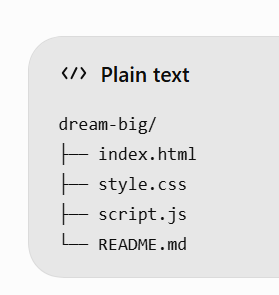
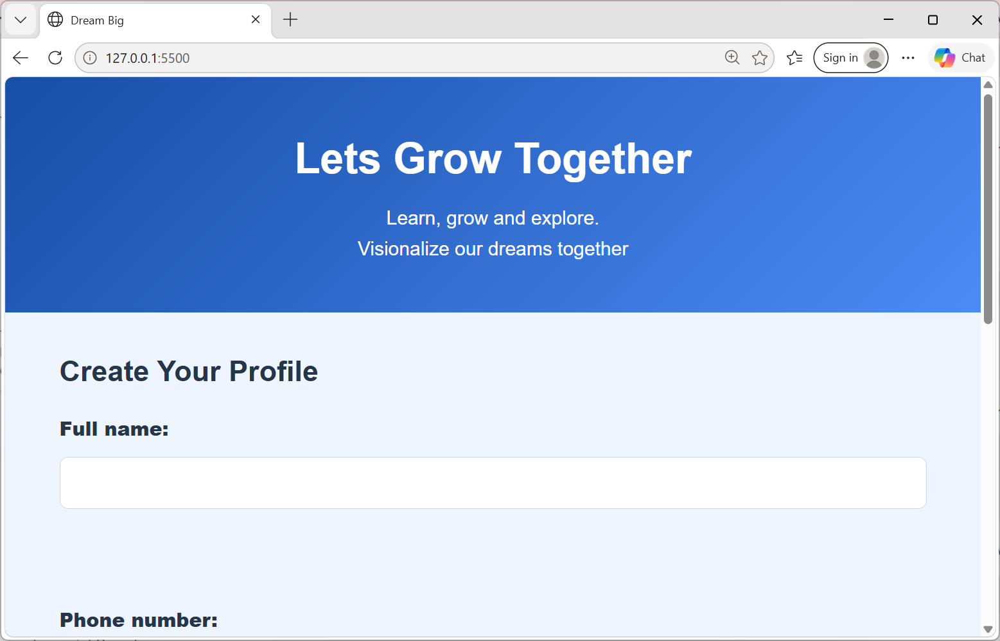

# Lets grow together
**link**:https://mercymumbe.github.io/personalized_webpage/
## Project Description

Lets grow together is a personalized webpage built using HTML, CSS, and JavaScript. It allows users to enter their names,phone numbers emails and ages, receive a personalized greeting, calculate their age in months, and read inspirational messages.

## Features

- Collects the user's name, phone number, email and age.
- Stores user details in localStorage.
- Displays a personalized greeting.
- Calculates age in months.
- Uses if...else to check age eligibility.
- Uses a loop to display five inspirational messages.
- Allows users to clear their profiles.
- Provides a responsive design.

## Technologies Used

- HTML5
- CSS3
- JavaScript
- localStorage
- Git and GitHub
-AI

## Project Structure

## Setup Instructions

### Run it on your computer
Clone the repository.

https://github.com/mercymumbe/personalized_webpage.git

Go into the project folder.

Search for  personalized webpage

Open index.html in your browser (Chrome, Firefox or Safari).

You can also right-click index.html in VS Code and choose Open with Live Server.

## Deploy to GitHub Pages

Push the project to a GitHub repository.
In the repository, go to Settings → Pages.
Under Branch, choose main and the / (root) folder.
Click Save.
Wait a few minutes for the website to be published.

## Screenshots

## Author

Mercy Mutua, Zindua School.

